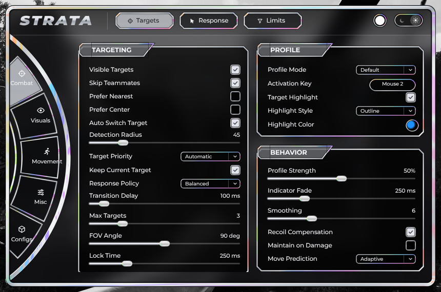
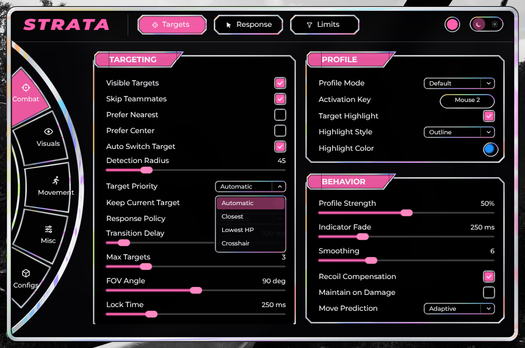

# STRATA UI

Кристальная стеклянная гуишка для Roblox: рамки с преломлением, колесо навигации, темы Glass / Dark и любой акцентный цвет.

| Glass | Dark + accent |
|---|---|
|  |  |

```lua
loadstring(game:HttpGet("https://raw.githubusercontent.com/n1xvare/STARA-UI/main/example.lua?t=" .. os.time()))()
```

**RightShift** — скрыть или показать. Круг в шапке открывает выбор цвета (HEX и RGB), луна/солнце переключает тему.

Кристальные рамки, логотип и иконки — готовые PNG в `assets/`. Они отрендерены в Chromium через SVG-фильтры: specular lighting, turbulence и радужная дисперсия. При первом запуске картинки скачиваются в `workspace/STRATA/`.

## API

```lua
local STRATA = loadstring(game:HttpGet("https://raw.githubusercontent.com/n1xvare/STARA-UI/main/STRATA.lua"))()
local Window = STRATA:CreateWindow({ ToggleKey = Enum.KeyCode.RightShift, Mode = "Glass", Accent = nil })
local Page = Window:Page({ Title = "Combat", Icon = "crosshair" })   -- плитка на колесе (до 5)
local Tab  = Page:Tab({ Title = "Targets", Icon = "crosshair" })     -- вкладка в шапке (до 3 на страницу)
local S    = Tab:Section({ Title = "Targeting", Side = "Left" })     -- Left / Right колонка

S:Toggle({ Title, Default, Flag, Callback })
S:Slider({ Title, Min, Max, Default, Increment, Suffix, Flag, Callback })
S:Dropdown({ Title, Options, Default, Multi, Flag, Callback })
S:Keybind({ Title, Default = Enum.KeyCode.E, Mode = "Hold" | "Toggle", Callback })
S:ColorPicker({ Title, Default, Pill, Callback })
S:Button({ Title, Callback })
S:Label("text")

STRATA:SetAccent(Color3.fromRGB(255, 96, 174))   -- nil = серебро
STRATA:SetMode("Dark")                            -- "Glass" / "Dark"
STRATA:SaveConfig("name") / STRATA:LoadConfig("name")
```

Иконки: crosshair, pointer, filter, eye, run, sliders, configs, moon, sun, chevron, check, user, globe, brush, keyboard, x, shield, bolt, save, folder.

Блюр стекла виден на средних и высоких настройках графики.
